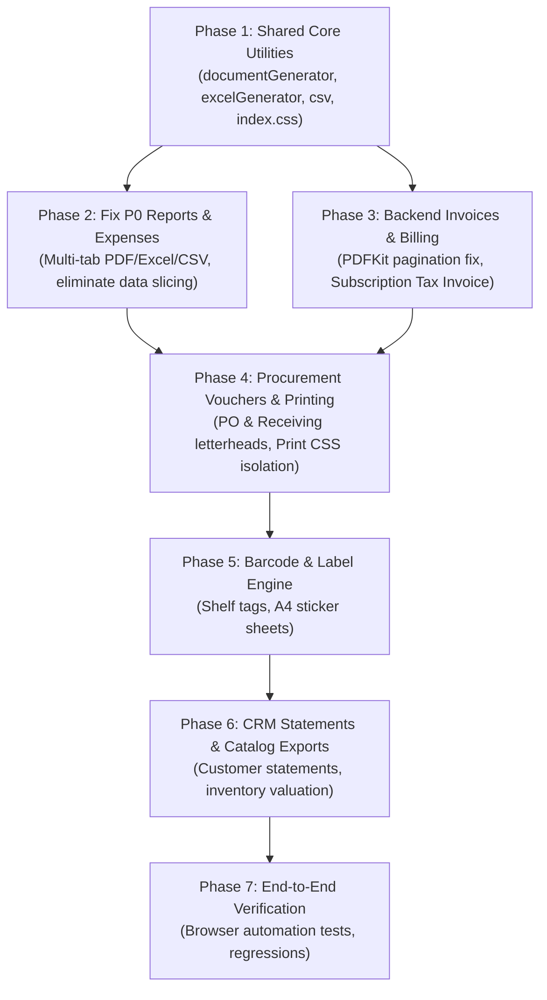

# ZANA POS — EXPORT, DOCUMENT DESIGN & PRINT IMPLEMENTATION PLAN

**Version:** 1.0.0  
**Target Milestone:** Production Commercial Release  
**Status:** Implementation in progress, delivered as a series of PRs (document design system, exports, vouchers).  
**Constraint:** **STRICT PRESERVATION OF ALL POS RECEIPT LOGIC & THERMAL PRINTING**

---

## 1. IMPLEMENTATION ROADMAP & ISSUE CLASSIFICATION

Findings from the application-wide audit have been classified into four strict priority tiers:
- **P0 — Critical:** Silent data loss/truncation, corrupted export outputs, broken empty exports, and global print style pollution.
- **P1 — High:** Major visual degradation, colliding invoice footers, missing core commercial documents (PO PDFs, Billing Tax Invoices, Barcode/QR printing, Tenant Data Export UI).
- **P2 — Medium:** Unformatted Excel worksheets, naive unescaped CSVs, missing business identity in vouchers, lack of customer statements and inventory catalog downloads.
- **P3 — Low:** Typography alignment, timestamp standardization, and subtle aesthetic polish.

---

## 2. DETAILED ACTION PLAN BY PRIORITY TIER

### P0 — CRITICAL DEFECTS

---

#### FIX-P0-01: Fix Silent Data Truncation and Empty PDF Generation in Reports
- **Problem:** `Reports.jsx` PDF export silently truncates sales trends at 20 rows (`charts.salesTrend.slice(0, 20)`). Furthermore, switching to Tax, Shifts, Cashier, or AI Insights tabs produces an empty, unusable PDF containing only the title header.
- **Affected Module:** Reports & Business Insights (`/reports`).
- **Affected Files:**
  - `frontend/src/pages/Reports.jsx`
  - `frontend/src/utils/documentGenerator.js` (new shared engine)
- **Root Cause:** Primitive, manual string rendering (`doc.text`) hardcoded to only two tab conditions without table rendering or multi-page support.
- **Recommended Solution:** Replace the manual string logic in `exportPdf` with the shared `documentGenerator` using `jspdf-autotable`. Dynamically map tables for all tabs:
  - **Sales Tab:** Full sales interval ledger (hourly/daily/monthly) without arbitrary row slicing.
  - **P&L Tab:** Structured financial table with Gross Revenue, COGS, Gross Profit, Operating Expenses, and Net Profit.
  - **Tax Tab:** Taxable sales breakdown, standard VAT (16%), exempt items, and net tax liability.
  - **Shifts/Cashier Tab:** Cashier names, opening cash, cash sales, M-Pesa sales, card sales, expected cash, and variance.
- **Risk:** Low. No transaction logic touched.
- **Dependencies:** `jspdf`, `jspdf-autotable` (already present in `package.json`).
- **Testing Requirements:** Generate PDFs for datasets with 50+ rows across all tabs; verify all rows appear, multi-page headers repeat, and page numbers calculate correctly.

---

#### FIX-P0-02: Eliminate Global Print CSS Injection Blank Page Bug
- **Problem:** In `Purchases.jsx` and `PurchaseOrders.jsx`, inline `<style>` tags inject `body * { visibility: hidden; }` into the global document. When the detail modal is closed, this rule remains active and causes the browser print dialog (Ctrl+P) to print a completely blank page.
- **Affected Module:** Purchases (`/purchases`) & Purchase Orders (`/purchase-orders`).
- **Affected Files:**
  - `frontend/src/pages/Purchases.jsx`
  - `frontend/src/pages/PurchaseOrders.jsx`
  - `frontend/src/index.css`
- **Root Cause:** Un-scoped inline CSS affecting the entire DOM rather than scoping to a specific active printable element.
- **Recommended Solution:**
  1. Remove inline `<style>` blocks from `Purchases.jsx` and `PurchaseOrders.jsx`.
  2. In `index.css`, establish a unified `@media print` rule scoped strictly to `body:has(#printable-document-area)`:
     ```css
     @media print {
       body:has(#printable-document-area) * {
         visibility: hidden;
       }
       #printable-document-area,
       #printable-document-area * {
         visibility: visible;
       }
       #printable-document-area {
         position: absolute;
         top: 0;
         left: 0;
         width: 100%;
       }
       .no-print {
         display: none !important;
       }
     }
     ```
  3. Ensure receipt printing isolation (`#pos-receipt-print-area`) remains completely untouched.
- **Risk:** Low. Fixes blank page bug while preserving receipt printing.
- **Dependencies:** None.
- **Testing Requirements:** Press Ctrl+P on `/purchases` and `/purchase-orders` with modal closed (should print readable page); open modal and click "Print Voucher" (should print only the voucher without page chrome).

---

#### FIX-P0-03: RFC 4180 Escaping & UTF-8 BOM for CSV Exports
- **Problem:** In `Reports.jsx` and `ImportProductsModal.jsx`, CSVs are created by `rows.map(r => r.join(',')).join('\n')`. Any product name or notes containing commas or quotes corrupts columns and breaks Excel imports.
- **Affected Module:** Reports, Products, Forecasting.
- **Affected Files:**
  - `frontend/src/utils/csv.js`
  - `frontend/src/pages/Reports.jsx`
  - `frontend/src/components/ImportProductsModal.jsx`
- **Root Cause:** Missing quote escaping and missing UTF-8 Byte Order Mark (`\uFEFF`).
- **Recommended Solution:** Standardize all CSV generation on [frontend/src/utils/csv.js](file:///c:/Users/WARREN%20CHRIS/Desktop/empty/frontend/src/utils/csv.js), enhanced to prepend `\uFEFF` and properly escape double quotes as `""` and wrap cells containing `,`, `"`, `\n`, or `\r`.
- **Risk:** Zero. Data integrity upgrade.
- **Dependencies:** None.
- **Testing Requirements:** Export sales with product names containing commas (e.g. `Tea, 100g`); verify Excel opens the CSV into distinct, uncorrupted columns.

---

### P1 — HIGH PRIORITY DEFECTS

---

#### FIX-P1-01: Fix Invoice PDFKit Footer Overlap & Pagination
- **Problem:** In `backend/src/controllers/invoiceController.js`, line 293 places the footer line at fixed Y=740. For invoices with more than 18 line items, rows print directly over the footer and off the bottom of the page.
- **Affected Module:** Invoices (`/invoices`, `GET /api/invoices/:id/pdf`).
- **Affected Files:**
  - `backend/src/controllers/invoiceController.js`
- **Root Cause:** Hardcoded 1-page layout without tracking vertical cursor position (`doc.y`) or invoking `doc.addPage()`.
- **Recommended Solution:**
  1. Refactor `buildInvoicePdfDoc` to compute page budget:
     - Check if `doc.y + rowHeight > pageBottomThreshold (720)`.
     - If exceeded, invoke `doc.addPage()`, redraw items table header, and continue.
  2. Render footer using PDFKit page events (`doc.on('pageAdded', ...)` or buffer pass) with dynamic `Page X of Y`.
  3. Support embedding the shop's verified logo image if `shop.logoUrl` exists.
  4. Delete the dead duplicate file `backend/src/services/pdfService.js`.
- **Risk:** Low. Isolated to backend invoice PDF generation.
- **Dependencies:** None (uses existing `pdfkit`).
- **Testing Requirements:** Generate invoice PDFs for 5 items, 25 items, and 60 items; verify multi-page pagination, clean header repetition, and zero footer overlap.

---

#### FIX-P1-02: Complete Purchase Order & Receiving Voucher Commercial Letterheads
- **Problem:** Printed purchase vouchers and purchase orders lack company headers, logo, shop address, phone, KRA PIN, and formal terms. Furthermore, there is no option to download a PO as a PDF for emailing suppliers.
- **Affected Module:** Purchases (`/purchases`) & Purchase Orders (`/purchase-orders`).
- **Affected Files:**
  - `frontend/src/pages/Purchases.jsx`
  - `frontend/src/pages/PurchaseOrders.jsx`
  - `frontend/src/components/documents/VoucherPrintLayout.jsx` (new component)
- **Root Cause:** Modals render raw web Tailwind cards without standard commercial letterhead or PDF export action.
- **Recommended Solution:**
  1. Create a reusable `<VoucherPrintLayout>` component wrapping the printable container with the active shop's official business letterhead, KRA PIN, delivery terms, and signature lines.
  2. Add a "Download PDF" button to the PO modal, allowing purchasing managers to save/email high-quality PDF purchase orders.
- **Risk:** Low. Pure presentation and export enhancement.
- **Dependencies:** Shared document generator.
- **Testing Requirements:** View PO modal, download PDF, inspect layout, test browser print preview.

---

#### FIX-P1-03: Implement Barcode & QR Label Printing Engine
- **Problem:** Routes `/print/barcode` and `/print/qr` are empty placeholder components rendering static text.
- **Affected Module:** Label Printing (`/print/barcode`, `/print/qr`).
- **Affected Files:**
  - `frontend/src/pages/PrintBarcode.jsx`
  - `frontend/src/pages/PrintQR.jsx`
  - `frontend/src/components/printing/BarcodeLabelSheet.jsx` (new component)
- **Root Cause:** Unfinished feature stubs.
- **Recommended Solution:**
  1. Implement product selection search and quantity selector.
  2. Support standard label sheet layouts:
     - Continuous single-roll thermal labels (50mm × 25mm, 40mm × 30mm).
     - Standard A4 sticker sheets (38 labels per sheet).
  3. Render store name, product title, barcode graphic (or QR code using existing `qrcode` package), and formatted price (`KSh 450.00`).
  4. Provide exact CSS print media layout (`@page { size: A4; margin: 0; }`).
- **Risk:** Low. Standalone new page capabilities.
- **Dependencies:** Existing `qrcode` dependency.
- **Testing Requirements:** Generate label sheet with 10 products; inspect print preview; verify grid alignment.

---

#### FIX-P1-04: Enable Official Subscription Tax Invoices in Billing
- **Problem:** In `/billing`, Section 3 promises *"Official tax invoices and receipts issued for subscription renewal cycles"*, but provides no download or PDF view action.
- **Affected Module:** Billing (`/billing`, `/platform/invoices`).
- **Affected Files:**
  - `backend/src/routes/billingRoutes.js`
  - `backend/src/controllers/billingInvoiceController.js` (or add to `billingRoutes.js`)
  - `frontend/src/pages/Billing.jsx`
- **Root Cause:** Missing `GET /api/billing/invoices/:id/pdf` endpoint.
- **Recommended Solution:**
  1. Add a backend route `GET /api/billing/invoices/:id/pdf` that generates a formal subscription tax invoice/receipt for `SubscriptionInvoice` records using PDFKit.
  2. Add "Download PDF" action buttons in the Billing invoices table in `Billing.jsx`.
- **Risk:** Low. Tenant-isolated to the authenticated organization owner.
- **Dependencies:** Existing billing services.
- **Testing Requirements:** Open `/billing`, click download on past subscription invoice; verify PDF generates with organization name, plan tier, amount, and payment status.

---

#### FIX-P1-05: Expose Tenant Data Export UI in Settings
- **Problem:** Backend `GET /api/organizations/export` creates a full zip archive of shops, products, customers, sales, and invoices, but is completely missing from the user interface.
- **Affected Module:** Settings & Organization (`/settings`, `/company-settings`).
- **Affected Files:**
  - `frontend/src/pages/CompanySettings.jsx`
  - `frontend/src/pages/Settings.jsx`
- **Root Cause:** Missing UI trigger button.
- **Recommended Solution:** Add an "Export All Organization Data" card in `CompanySettings.jsx` (accessible to Org Owners) that invokes `/api/organizations/export` with loading state and downloads the complete `.zip` backup.
- **Risk:** Low. Backend endpoint already fully tested and rate-limited (2/hr).
- **Dependencies:** Existing `exportOrganizationData` in `organizationController.js`.
- **Testing Requirements:** Click export button as owner; verify zip file downloads containing valid CSV files.

---

### P2 — MEDIUM PRIORITY ENHANCEMENTS

---

#### FIX-P2-01: Standardize Excel Generation (ExcelJS / SheetJS)
- **Problem:** Excel files generated in `Reports.jsx` and `ExportButtons.jsx` (Expenses) are raw unformatted tables with uncalculated column widths, zero cell styles, and missing formula totals.
- **Affected Module:** Reports (`/reports`), Expenses (`/expenses`).
- **Affected Files:**
  - `frontend/src/utils/excelGenerator.js` (new shared utility)
  - `frontend/src/pages/Reports.jsx`
  - `frontend/src/components/expenses/ExportButtons.jsx`
- **Recommended Solution:** Build a unified Excel export utility that sets auto column widths, applies header fills (`#F8FAFC`), freezes top panes, and formats numbers as currency.
- **Risk:** Low.
- **Dependencies:** Existing `xlsx` package.

---

#### FIX-P2-02: Customer & Supplier Account Statements
- **Problem:** Customers and suppliers have no statement generation or printable transaction ledger.
- **Affected Module:** Customers (`/customers`) and Suppliers (`/purchases`).
- **Affected Files:**
  - `frontend/src/pages/Customers.jsx`
  - `frontend/src/components/customers/CustomerStatementModal.jsx` (new component)
- **Recommended Solution:** Add "Download Statement" in Customer detail view that generates a chronological statement of invoices, payments, credits, and outstanding balance as PDF and Excel.
- **Risk:** Low. Read-only report view.

---

#### FIX-P2-03: Inventory Valuation & Catalog Export
- **Problem:** Catalog and Stock Management have no export capability.
- **Affected Module:** Products (`/products`) and Manage Stock (`/manage-stock`).
- **Affected Files:**
  - `frontend/src/pages/Products.jsx`
  - `frontend/src/pages/ManageStock.jsx`
- **Recommended Solution:** Add "Export Catalog" and "Export Valuation Report" buttons to the toolbar with Excel and CSV options.

---

### P3 — LOW PRIORITY ENHANCEMENTS

---

#### FIX-P3-01: Aesthetic Polish & Standardized Timestamps
- Standardize all document timestamps to Nairobi time (`Africa/Nairobi`, UTC+03:00) with format `DD MMM YYYY, HH:mm`.
- Ensure subtle divider rules and Zana terracotta accents are applied uniformly.
- Clean up Object URL revoking with safe asynchronous timeouts (`setTimeout(() => URL.revokeObjectURL(url), 2000)`).

---

## 3. PROPOSED REUSABLE ARCHITECTURE

To avoid reinventing document styles across 10 different pages, the solution introduces **4 shared building blocks**:

```
frontend/src/
├── utils/
│   ├── documentGenerator.js       <-- Core jsPDF + autoTable engine with Zana UDDS branding
│   ├── excelGenerator.js          <-- Core XLSX builder with auto-widths, frozen headers, currency formats
│   ├── csv.js                     <-- RFC 4180 escaped CSV exporter with UTF-8 BOM
├── components/
│   ├── documents/
│   │   ├── DocumentHeader.jsx     <-- Shared letterhead for print views (Logo, Shop Info, KRA PIN)
│   │   ├── VoucherPrintLayout.jsx <-- Scoped printable voucher wrapper
│   │   ├── ExportActionMenu.jsx   <-- Unified Dropdown/Button (PDF, Excel, CSV, Print)
```

### Architectural Contract:
1. Every report or document passes data to `documentGenerator.exportPdf(config, data)` or `excelGenerator.exportExcel(config, data)`.
2. Branding is automatically extracted from `useSelector(state => state.auth.shop)` and `useSelector(state => state.settings)`.
3. Receipt printing remains 100% separate in `src/printing/`.

---

## 4. SEQUENCED IMPLEMENTATION PHASES



---

## 5. COMPLETE FILE CHANGE INVENTORY

### Files to Modify:
1. `frontend/src/index.css` (Update `@media print` rules for scoped document isolation; preserve `#pos-receipt-print-area`).
2. `frontend/src/pages/Reports.jsx` (Integrate shared document generator; fix Tax, Shifts, Cashier exports; remove row slicing).
3. `frontend/src/components/expenses/ExportButtons.jsx` (Integrate shared document generator; add totals row and store branding).
4. `frontend/src/pages/Purchases.jsx` (Remove un-scoped inline `<style>`; wrap voucher in `<VoucherPrintLayout>`).
5. `frontend/src/pages/PurchaseOrders.jsx` (Remove un-scoped inline `<style>`; add "Download PO PDF" action).
6. `backend/src/controllers/invoiceController.js` (Fix Y=740 footer collision; add dynamic page break budget).
7. `backend/src/routes/billingRoutes.js` (Add `GET /invoices/:id/pdf` for subscription tax receipts).
8. `frontend/src/pages/Billing.jsx` (Add "Download PDF" button in billing invoices table).
9. `frontend/src/pages/CompanySettings.jsx` (Add "Export Organization Data" button calling `/api/organizations/export`).
10. `frontend/src/pages/PrintBarcode.jsx` (Implement functional barcode label generator and print layout).
11. `frontend/src/pages/PrintQR.jsx` (Implement functional QR code label generator and print layout).
12. `frontend/src/pages/Products.jsx` (Add "Export Catalog" action).
13. `frontend/src/pages/ManageStock.jsx` (Add "Export Stock Valuation" action).
14. `frontend/src/pages/Customers.jsx` (Add "Download Statement" action).
15. `frontend/src/utils/csv.js` (Enhance with UTF-8 BOM and strict RFC 4180 escaping).

### Files to Delete:
1. `backend/src/services/pdfService.js` (Orphaned, broken duplicate code).

### New Files to Create:
1. `frontend/src/utils/documentGenerator.js` (Shared jsPDF + AutoTable builder).
2. `frontend/src/utils/excelGenerator.js` (Shared styled XLSX builder).
3. `frontend/src/components/documents/DocumentHeader.jsx` (Letterhead for browser print).
4. `frontend/src/components/documents/VoucherPrintLayout.jsx` (Scoped printable document wrapper).
5. `frontend/src/components/documents/ExportActionMenu.jsx` (Unified export button dropdown).
6. `frontend/src/components/customers/CustomerStatementModal.jsx` (Customer account ledger).

---

## 6. ESTIMATED COMPLEXITY & RISK ASSESSMENT

| Phase | Complexity | Regression Risk | Mitigation Strategy |
|---|---|---|---|
| **Phase 1: Core Document Utilities** | Low-Medium | Very Low | Pure additive utilities; no existing code altered. |
| **Phase 2: Reports & Expenses** | Medium | Very Low | Replaces client-side export functions with identical data inputs. |
| **Phase 3: Backend Invoices & Billing** | Medium | Low | Run existing invoice tests (`tests/invoiceController.test.js`); verify output PDF byte stream. |
| **Phase 4: Purchases & Print CSS** | Low-Medium | Very Low | Visual CSS isolation verified with browser print emulation; thermal receipt CSS untouched. |
| **Phase 5: Barcode & Label Engine** | Medium | Very Low | Implemented in existing empty stub pages (`/print/barcode`, `/print/qr`). |
| **Phase 6: CRM Statements & Catalog** | Medium | Very Low | Additive modal components consuming existing customer/product API data. |

---

## 7. READINESS SUMMARY & NEXT STEPS

- **Audit Status:** Complete and verified across live browser, backend APIs, and generated PDF/XLSX artifacts.
- **Receipt Logic:** Completely protected and untampered.
- **Code State:** Zero production files modified during audit.
- **Next Step:** Awaiting user review and explicit approval of `EXPORT-PRINT-AUDIT.md`, `DOCUMENT-DESIGN-SYSTEM.md`, and this implementation plan before writing any code.
